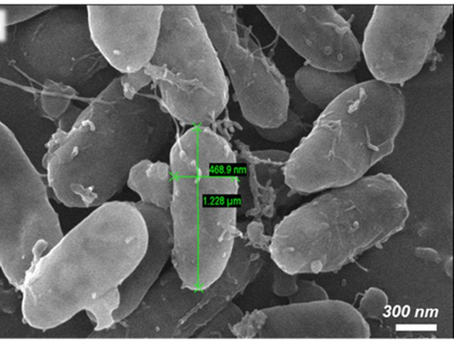
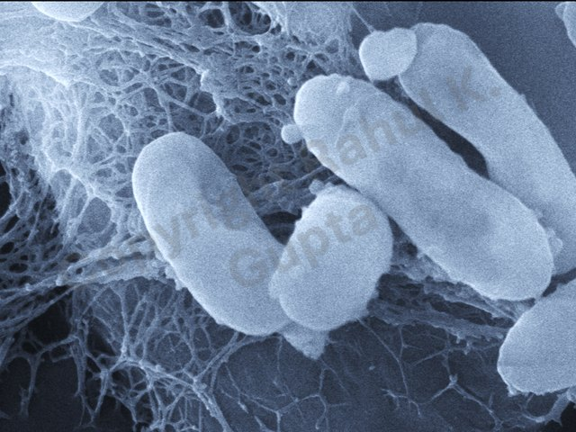
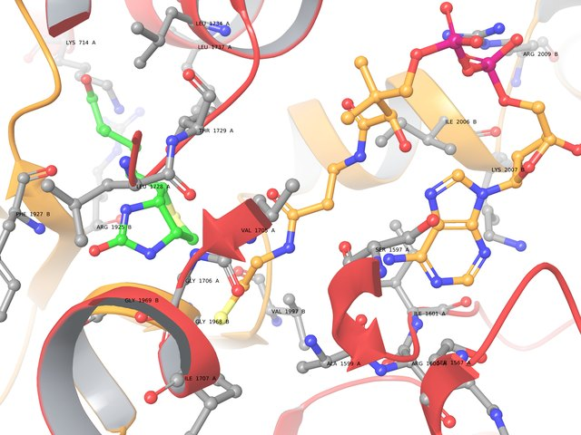
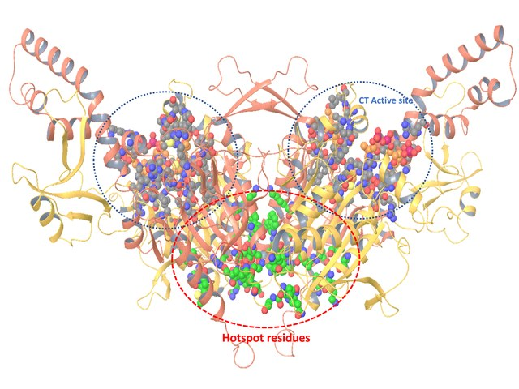
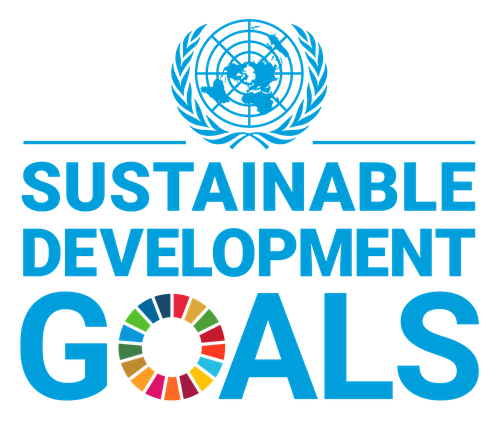
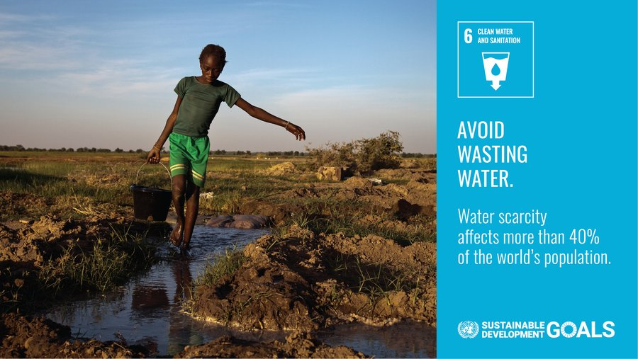
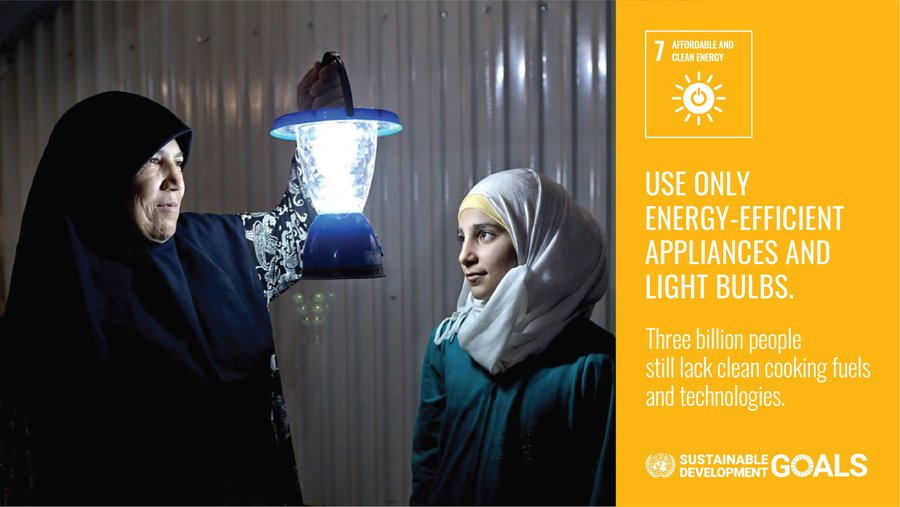
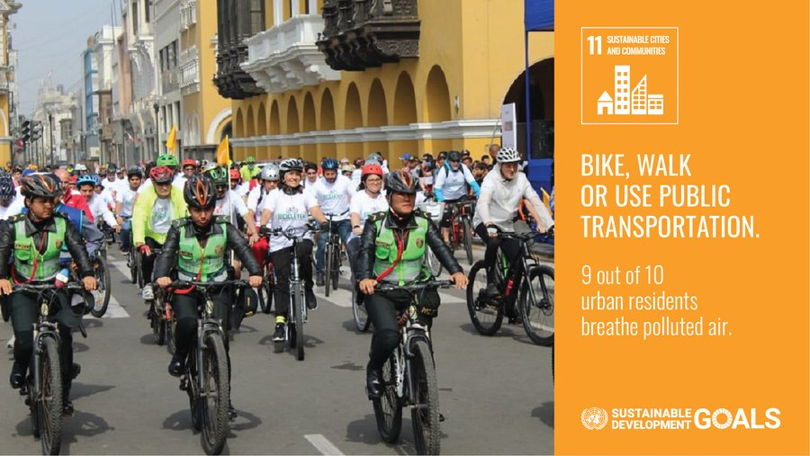
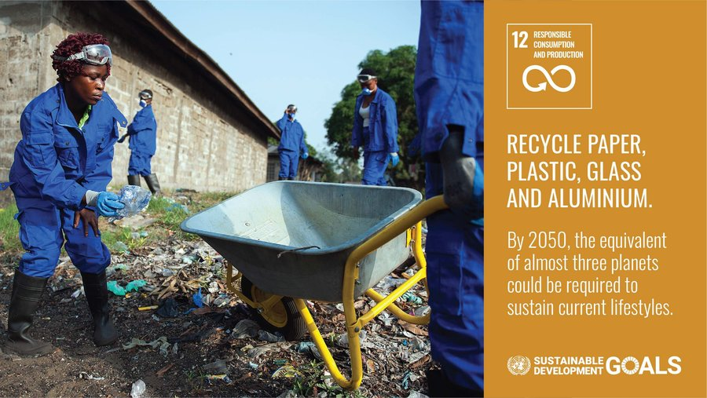
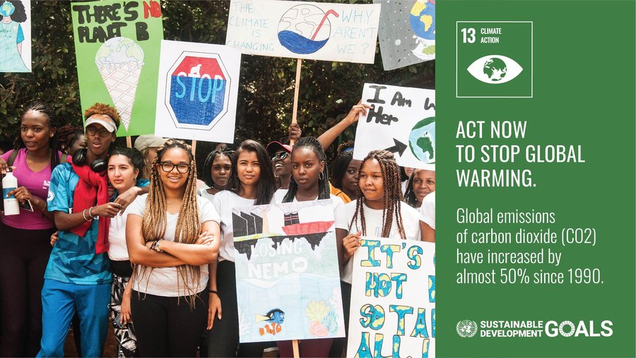



  

    Research focus
    <strong>Enzyme engineering, immobilization and C1 bioconversion</strong>
  

  <figure><figcaption>HR-FE-SEM of <em>Pseudomonas</em> sp. KHU-1</figcaption></figure>
  <figure><figcaption>FE-SEM micrograph</figcaption></figure>
  <figure><figcaption>Residue contacts in the ACC model</figcaption></figure>
  <figure><figcaption>ACC hotspot residues</figcaption></figure>

I am a Research Professor in the Department of Chemical Engineering at Kyung Hee University (since May 2026), where I lead process development for a synthetic-biology platform that converts greenhouse gases into plant-growth-promoting biomaterials, with Prof. Eun Yeol Lee. I joined the department as a postdoctoral researcher in May 2025. My research combines enzyme engineering, enzyme and whole-cell immobilization, and nanomaterial synthesis to develop stable, reusable biocatalysts for bioconversion and environmental remediation.

Current work addresses biological fixation of C1 gases, engineered alginate-based biomaterials for whole-cell environmental remediation, and systems-guided metabolic engineering of microbial hosts for value-added products from renewable feedstocks (see [research]({{ '/projects/' | relative_url }})).

Supported by a Brain Korea 21 (BK21) fellowship, I received my Ph.D. in Chemical Engineering from Konkuk University, Seoul (2025), where my thesis, supervised by Prof. Jung-Kul Lee, addressed the engineering and immobilization of enzymes to improve their activity and stability. Before doctoral study, I worked as a Project Assistant at CSIR-Institute of Genomics and Integrative Biology and as a Project Fellow at AIIMS, New Delhi. I hold an M.Sc. in Biotechnology from Jamia Hamdard, New Delhi (2016), and a B.Sc. in Biotechnology from Chaudhary Charan Singh University, Meerut (2014).

My work comprises 22 peer-reviewed articles (900+ citations; h-index 16, i10-index 20) and five Korean patents covering enzyme-variant engineering, cofactor-regenerating metal–organic frameworks, and methanotroph immobilization for methanol production. Recognition includes the AMI–Prof. J. V. Bhat Award of the Association of Microbiologists of India (2021) and a Horizon Europe Seal of Excellence from the European Commission (2026). I supervise doctoral and master's students, teach protein engineering and biocatalysis, and have reviewed more than 160 manuscripts for over 40 journals.

  <a class="btn btn-sm z-depth-0" role="button" href="{{ '/assets/pdf/visiting_card.pdf' | relative_url }}" download="Rahul_K_Gupta_visiting_card.pdf"><i class="fa-solid fa-id-card"></i> Download visiting card (PDF)</a>
  <a class="btn btn-sm z-depth-0" role="button" href="{{ '/assets/img/visiting_card.png' | relative_url }}" download="Rahul_K_Gupta_visiting_card.png"><i class="fa-solid fa-image"></i> PNG</a>

**Research interests:** fermentation technology and bioprocess optimization; enzyme catalysis and engineering; enzyme immobilization; enzyme–inorganic hybrid nanoflowers; methanotrophic C1 bioconversion; bioremediation of environmental contaminants.

  
  <strong>UN Sustainable Development Goals</strong> addressed by this research (SDG 6, 7, 11, 12 and 13, as tagged on <a href="https://orcid.org/0009-0005-6077-3122">ORCID</a>). <em class="rkg-sdg-hint">Click to show or hide the goal cards.</em>

  

Engineered alginate-based materials for whole-cell remediation, and laccase-based nanobiocatalysts that degrade bisphenol A and decolorize dyes, target pollutants in contaminated water.

  

Immobilized biocatalysts convert biogas to methanol and lignocellulosic biomass to hydrogen and ethanol, which supports renewable fuel production.

  

Organic waste streams, including potato peels, rice straw and biodiesel-industry effluent, were converted into fuels and value-added products, which is relevant to municipal and industrial waste management.

  

Biomass residues and process by-products such as glycerol serve as feedstocks, and reusable immobilized enzymes and cells reduce the consumption of biocatalysts.

  

Methanotrophs immobilized in engineered matrices convert methane and other greenhouse gases to methanol, which offers a biological route to reducing greenhouse gas emissions.

  

    
  

