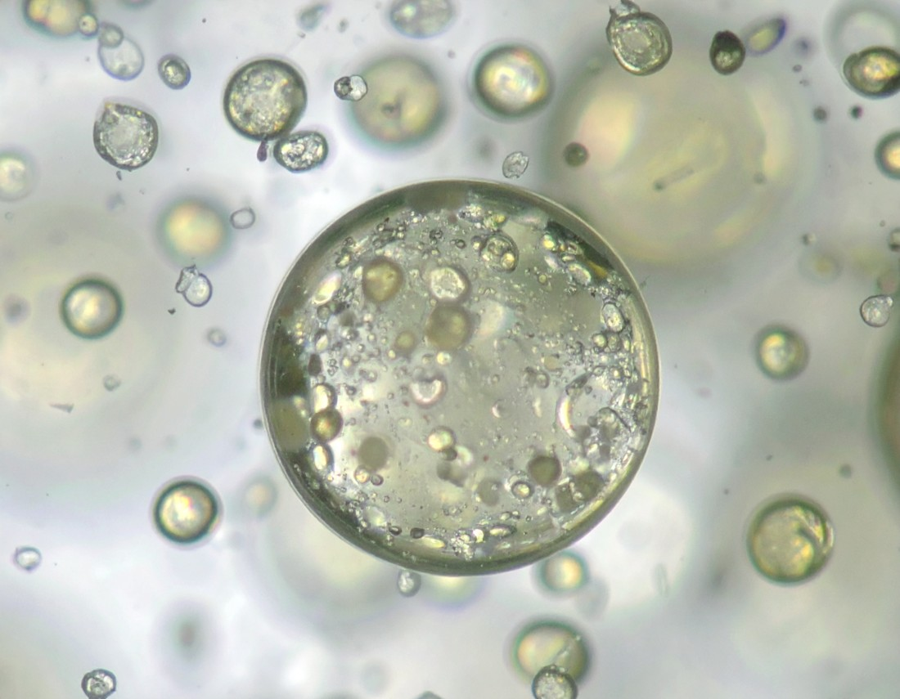
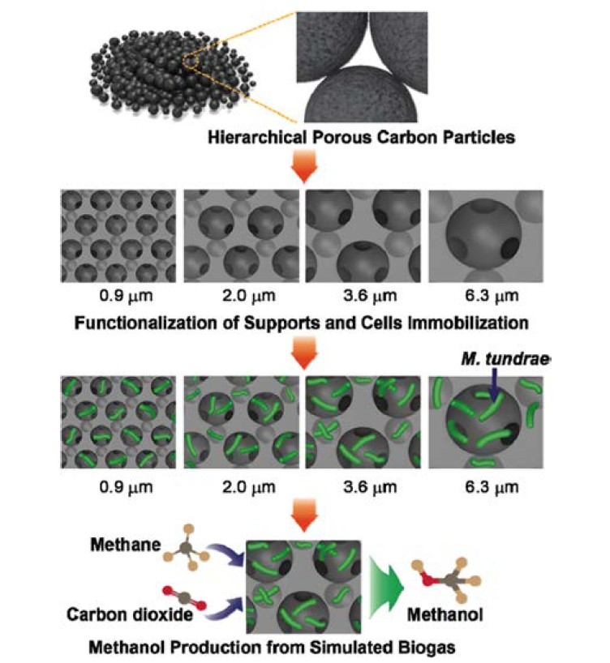
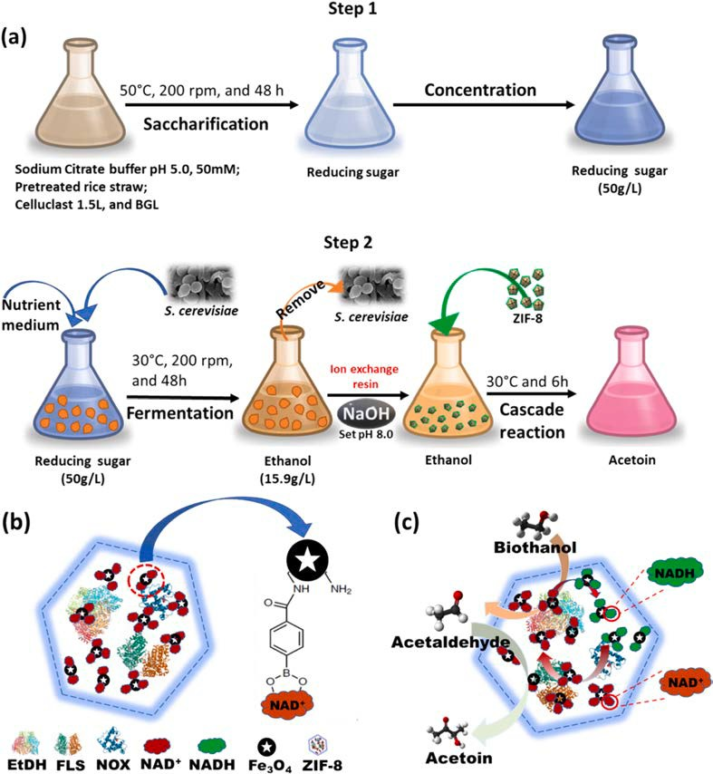
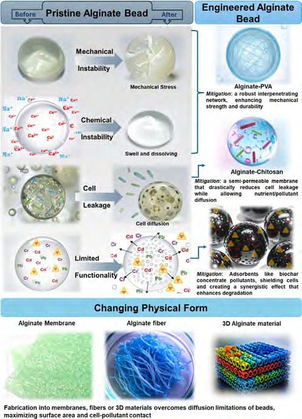
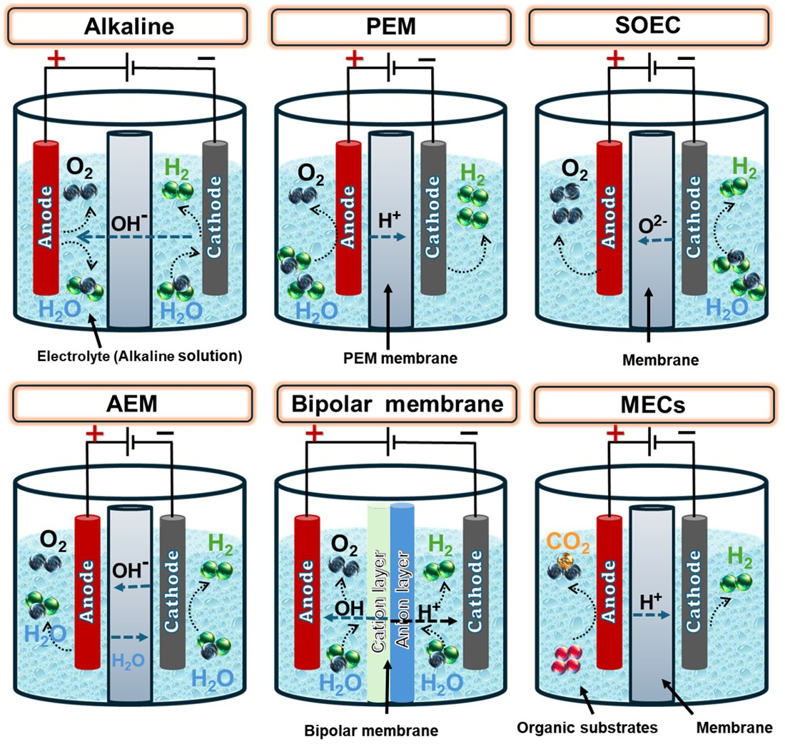
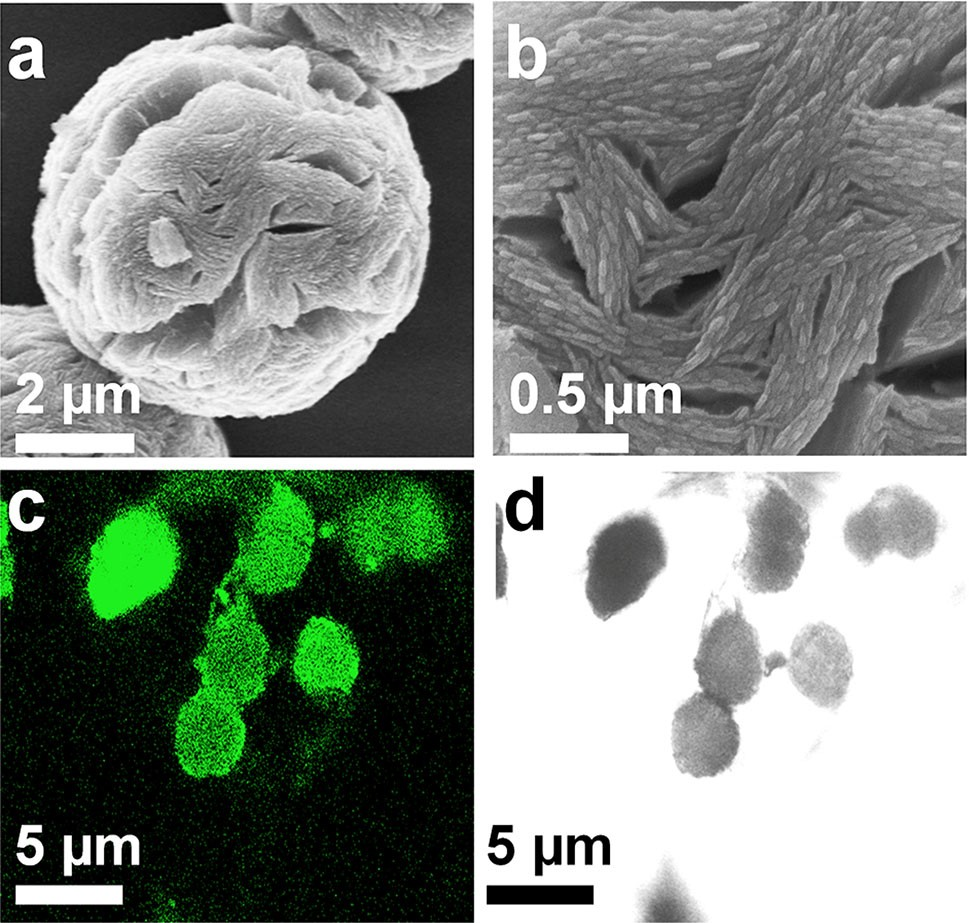
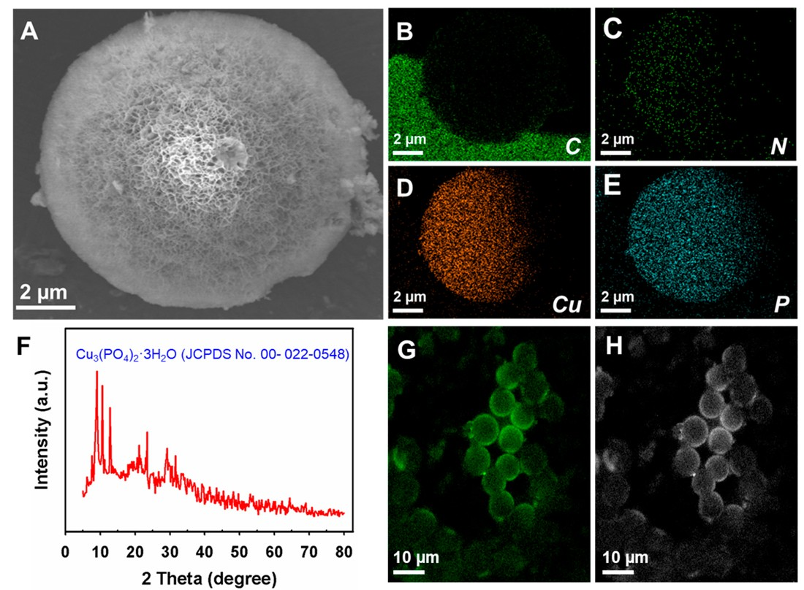
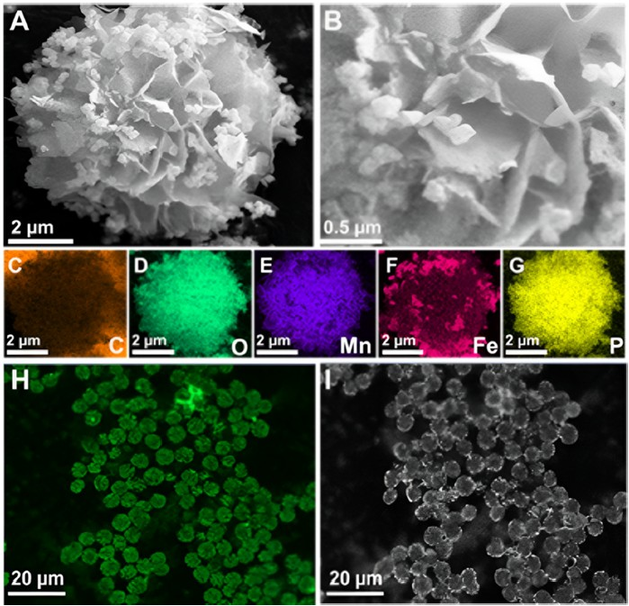
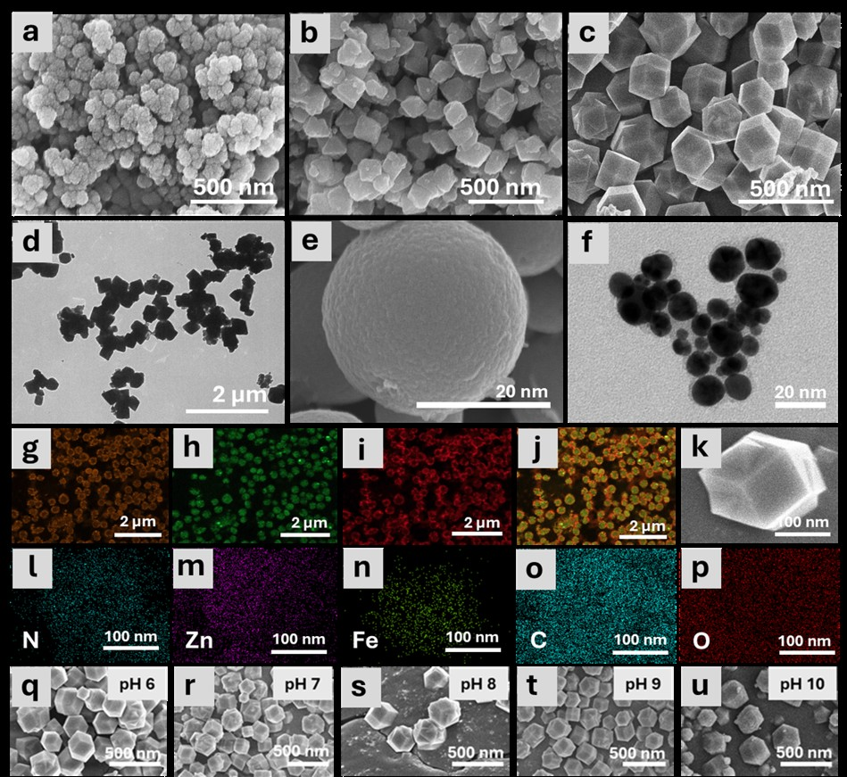



  

    <figure class="rkg-slide" data-rkg-index="0" style="display:block;">
      
      <figcaption>
        
A whole-cell-immobilized alginate bead.

        
Gupta, R. K. &amp; Lee, E. Y. <i>ChemSusChem</i> 2026, 19(1), e202501882. &middot; <a href="https://doi.org/10.1002/cssc.202501882" target="_blank" rel="noopener">doi.org/10.1002/cssc.202501882</a>

      </figcaption>
    </figure>

    <figure class="rkg-slide" data-rkg-index="1" style="display:none;">
      
      <figcaption>
        
Hierarchical porous carbon particles functionalized for whole-cell immobilization and methanol production from simulated biogas.

        
Patel, S. K. S., Jeon, M. S., Gupta, R. K., et al. <i>ACS Appl. Mater. Interfaces</i> 2019, 11(21), 18968&ndash;18977. &middot; <a href="https://doi.org/10.1021/acsami.9b03420" target="_blank" rel="noopener">doi.org/10.1021/acsami.9b03420</a>

      </figcaption>
    </figure>

    <figure class="rkg-slide" data-rkg-index="2" style="display:none;">
      
      <figcaption>
        
Bioethanol production from rice-straw biomass, used as feedstock for cascade acetoin production.

        
Gupta, R. K., Patel, S. K. S. &amp; Lee, J.-K. <i>Bioresour. Technol.</i> 2024, 408, 131175. &middot; <a href="https://doi.org/10.1016/j.biortech.2024.131175" target="_blank" rel="noopener">doi.org/10.1016/j.biortech.2024.131175</a>

      </figcaption>
    </figure>

    <figure class="rkg-slide" data-rkg-index="3" style="display:none;">
      
      <figcaption>
        
Strategies for engineering alginate biocatalysts to overcome the inherent limitations of the pristine bead.

        
Gupta, R. K. &amp; Lee, E. Y. <i>ChemSusChem</i> 2026, 19(1), e202501882. &middot; <a href="https://doi.org/10.1002/cssc.202501882" target="_blank" rel="noopener">doi.org/10.1002/cssc.202501882</a>

      </figcaption>
    </figure>

    <figure class="rkg-slide" data-rkg-index="4" style="display:none;">
      
      <figcaption>
        
Hydrogen production through alkaline, PEM, SOEC, AEM, bipolar-membrane, and microbial electrolysis routes.

        
Patel, S. K. S., Gupta, R. K., Rohit, M. V. &amp; Lee, J.-K. <i>Fire</i> 2024, 7(7), 233. &middot; <a href="https://doi.org/10.3390/fire7070233" target="_blank" rel="noopener">doi.org/10.3390/fire7070233</a>

      </figcaption>
    </figure>

    <figure class="rkg-slide" data-rkg-index="5" style="display:none;">
      
      <figcaption>
        
Characterization of the synthesized &beta;-glucosidase&ndash;Zn&#8323;(PO&#8324;)&#8322; hybrid.

        
Patel, S. K. S., Gupta, R. K., et al. <i>Indian J. Microbiol.</i> 2019, 59(3), 370&ndash;374. &middot; <a href="https://doi.org/10.1007/s12088-019-00796-z" target="_blank" rel="noopener">doi.org/10.1007/s12088-019-00796-z</a>

      </figcaption>
    </figure>

    <figure class="rkg-slide" data-rkg-index="6" style="display:none;">
      
      <figcaption>
        
FE-SEM imaging, elemental mapping, and XRD of the synthesized Cu&ndash;laccase protein&ndash;inorganic hybrid.

        
Patel, S. K. S., Gupta, R. K. &amp; Lee, J.-K. <i>J. Xenobiot.</i> 2025, 15(4), 108. &middot; <a href="https://doi.org/10.3390/jox15040108" target="_blank" rel="noopener">doi.org/10.3390/jox15040108</a>

      </figcaption>
    </figure>

    <figure class="rkg-slide" data-rkg-index="7" style="display:none;">
      
      <figcaption>
        
FE-SEM and EDS analysis of a <i>Trametes versicolor</i> laccase magnetic protein&ndash;inorganic hybrid.

        
Patel, S. K. S., Gupta, R. K., et al. <i>Materials</i> 2024, 17(8), 1790. &middot; <a href="https://doi.org/10.3390/ma17081790" target="_blank" rel="noopener">doi.org/10.3390/ma17081790</a>

      </figcaption>
    </figure>

    <figure class="rkg-slide" data-rkg-index="8" style="display:none;">
      
      <figcaption>
        
Crystal growth and characterization of the ZIF-8@Fe&#8323;O&#8324;/NAD&#8314; enzyme-nanoflower biocatalyst.

        
Gupta, R. K., Patel, S. K. S. &amp; Lee, J.-K. <i>Bioresour. Technol.</i> 2024, 408, 131175. &middot; <a href="https://doi.org/10.1016/j.biortech.2024.131175" target="_blank" rel="noopener">doi.org/10.1016/j.biortech.2024.131175</a>

      </figcaption>
    </figure>

  

  <button type="button" class="rkg-arrow rkg-prev" aria-label="Previous slide" onclick="rkgGalleryGo(-1)">&#10094;</button>
  <button type="button" class="rkg-arrow rkg-next" aria-label="Next slide" onclick="rkgGalleryGo(1)">&#10095;</button>

  

    <button type="button" class="rkg-dot rkg-dot-active" aria-label="Slide 1" onclick="rkgGallerySet(0)"></button>
    <button type="button" class="rkg-dot" aria-label="Slide 2" onclick="rkgGallerySet(1)"></button>
    <button type="button" class="rkg-dot" aria-label="Slide 3" onclick="rkgGallerySet(2)"></button>
    <button type="button" class="rkg-dot" aria-label="Slide 4" onclick="rkgGallerySet(3)"></button>
    <button type="button" class="rkg-dot" aria-label="Slide 5" onclick="rkgGallerySet(4)"></button>
    <button type="button" class="rkg-dot" aria-label="Slide 6" onclick="rkgGallerySet(5)"></button>
    <button type="button" class="rkg-dot" aria-label="Slide 7" onclick="rkgGallerySet(6)"></button>
    <button type="button" class="rkg-dot" aria-label="Slide 8" onclick="rkgGallerySet(7)"></button>
    <button type="button" class="rkg-dot" aria-label="Slide 9" onclick="rkgGallerySet(8)"></button>
  

All figures are the author's own, drawn from published work; full citations and DOIs are linked under each image. See also the complete <a href="{{ '/publications/' | relative_url }}">publication list</a>.

