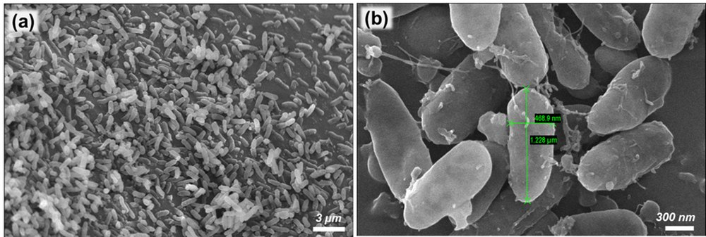



<figure class="rkg-pfig"><figcaption>HR-FE-SEM images of Pseudomonas sp. KHU-1, the microbial host used in this work.</figcaption></figure>

Microbial hosts can convert low-value renewable feedstocks into higher-value products when their metabolism is redirected with systems-level guidance. This project applies that approach to glycerol, a by-product of biodiesel production, in _Pseudomonas_ sp. KHU-1. Systems-guided analysis of glycerol valorization revealed an NADPH-driven switch in metabolic routing that supports high-titer auxin production . These findings point to cofactor supply as a lever for pathway engineering in this host and provide a basis for designing strains that direct carbon toward plant-growth-promoting compounds.

