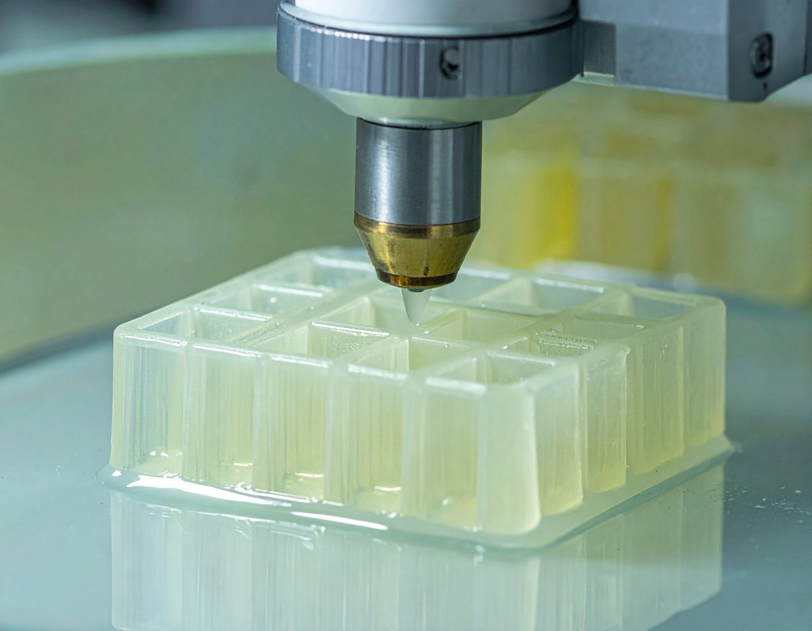



<figure class="rkg-pfig"><figcaption>Extrusion bioprinting of a hydrogel scaffold. Illustrative image (AI-generated), not experimental data.</figcaption></figure>

Three-dimensional bioprinting deposits hydrogel-based materials with defined geometry, which gives control over porosity, mass transfer, and cell loading. This project explores printed hydrogel scaffolds as carriers for whole-cell biocatalysts in the conversion of C1 gases. Printed scaffolds are expected to combine a high local cell density with easy recovery and reuse, which are advantages over free-cell suspensions. The work addresses scaffold design, printability, and the retention of catalytic activity in the immobilized cells. Detailed methods and results will be added after publication.

