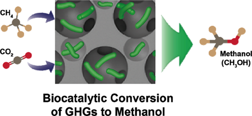



<figure class="rkg-pfig"><figcaption>Biocatalytic conversion of greenhouse gases (CH4 and CO2) to methanol by whole cells immobilized in a porous matrix.</figcaption></figure>

Methanotrophs oxidize methane to methanol through methane monooxygenase, which offers higher selectivity under mild conditions than thermochemical routes. Whole-cell immobilization improves methane oxidation performance and allows cell reuse. Earlier work encapsulated methanotrophs in polymer matrices containing copper, iron, or magnetic nanoparticles and used simulated biogas and wheat-straw-derived biogas as feedstocks. Cells were also immobilized on chemically modified chitosan, banana leaves, and hierarchical macroporous particles, and methanotroph co-cultures were designed to raise methanol production. These studies examine how carrier chemistry and cell composition affect methanol formation from greenhouse gases.

**Related publications**

- Hierarchical Macroporous Particles for Efficient Whole-Cell Immobilization: Application in Bioconversion of Greenhouse Gases to Methanol. *ACS Applied Materials & Interfaces* 2019. [doi:10.1021/acsami.9b03420](https://doi.org/10.1021/acsami.9b03420)
- Conversion of biogas to methanol by methanotrophs immobilized on chemically modified chitosan. *Bioresource Technology* 2020. [doi:10.1016/j.biortech.2020.123791](https://doi.org/10.1016/j.biortech.2020.123791)
- Biomethanol Production from Methane by Immobilized Co-cultures of Methanotrophs. *Indian Journal of Microbiology* 2020. [doi:10.1007/s12088-020-00883-6](https://doi.org/10.1007/s12088-020-00883-6)
- Integrating anaerobic digestion of potato peels to methanol production by methanotrophs immobilized on banana leaves. *Bioresource Technology* 2021. [doi:10.1016/j.biortech.2020.124550](https://doi.org/10.1016/j.biortech.2020.124550)
- Synthetic design of methanotroph co-cultures and their immobilization within polymers containing magnetic nanoparticles to enhance methanol production from wheat straw-based biogas. *Bioresource Technology* 2022. [doi:10.1016/j.biortech.2022.128032](https://doi.org/10.1016/j.biortech.2022.128032)
- Encapsulation of Methanotrophs within a Polymeric Matrix Containing Copper- and Iron-Based Nanoparticles to Enhance Methanol Production from a Simulated Biogas. *Polymers* 2023. [doi:10.3390/polym15183667](https://doi.org/10.3390/polym15183667)
- Polyhydroxyalkanoate Production by Methanotrophs: Recent Updates and Perspectives. *Polymers* 2024. [doi:10.3390/polym16182570](https://doi.org/10.3390/polym16182570)
