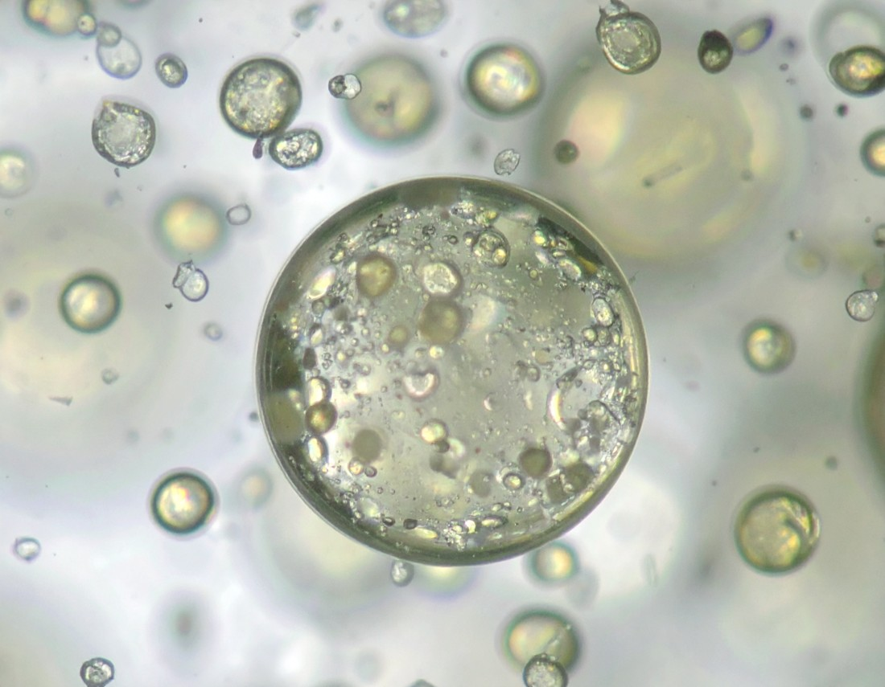
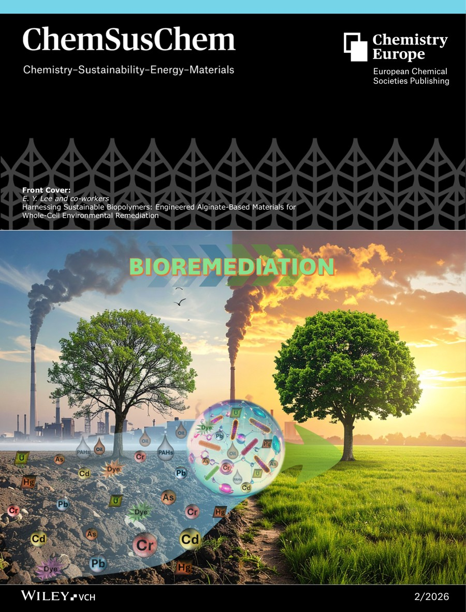



<figure class="rkg-pfig"><figcaption>A whole-cell-immobilized biopolymer for bioconversion.</figcaption></figure>
<figure class="rkg-pfig"><figcaption>Front cover, ChemSusChem 19(2) 2026.</figcaption></figure>

Alginate is a low-cost, biocompatible biopolymer widely used to entrap whole cells. Entrapment protects the cells from environmental stress and allows their recovery and reuse, but pristine beads have inherent limitations. A review of engineering strategies for alginate-based materials addresses how these limitations can be overcome and how engineered alginate carriers support whole-cell environmental remediation . The article was selected for the front cover of _ChemSusChem_ (19(2), 2026).

