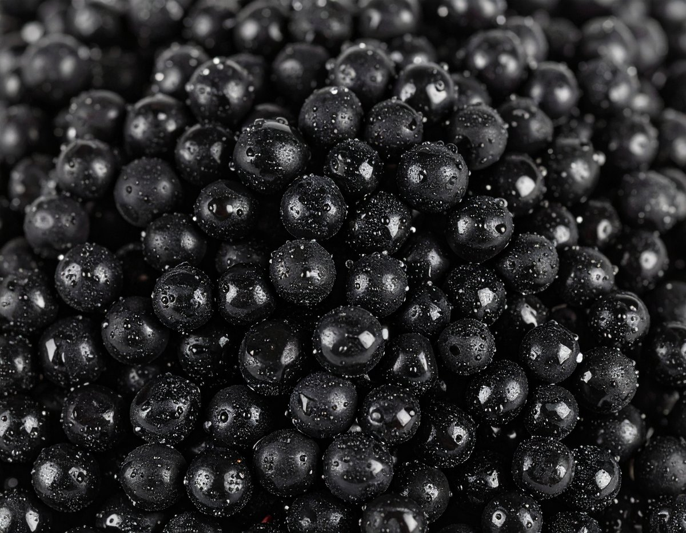



<figure class="rkg-pfig"><figcaption>Concept image of biopolymer beads for microbial biofertilizer delivery. Illustrative image (AI-generated), not experimental data.</figcaption></figure>

Microbial biofertilizers can reduce the dependence of crop production on synthetic fertilizers, but their performance depends on how living cells are formulated and delivered. This project develops biopolymer-based cell composites as delivery formats that protect microbial cells during storage and application. The work focuses on formulation design and on compatibility with agricultural use, with the aim of coupling improved crop nutrition with lower greenhouse-gas emissions. Detailed formulations and results will be added after publication.

