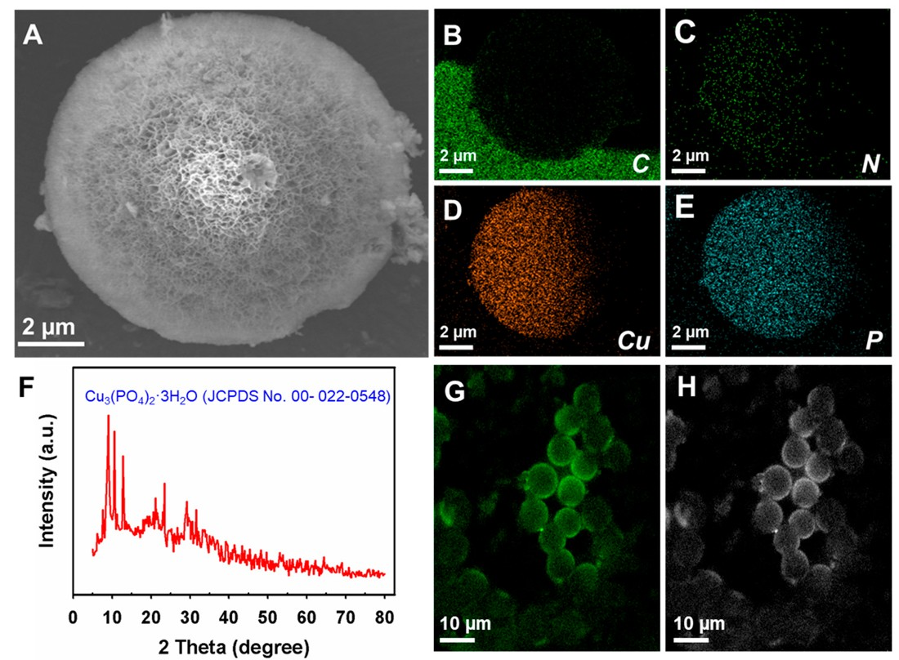



<figure class="rkg-pfig"><figcaption>FE-SEM, elemental mapping, and XRD of a Cu-laccase protein-inorganic hybrid (Patel et al., J. Xenobiot. 2025).</figcaption></figure>

Enzyme–metal hybrid nanoflowers form in phosphate-buffered saline through nucleation, aggregation, and anisotropic growth, most often with cobalt, copper, manganese, or zinc ions. The hybrid structure improves enzyme stability and catalytic performance relative to the free enzyme. Related work includes a magnetic laccase hybrid for dye decolorization in the presence of inhibitors (2024), a laccase hybrid applied to biomass saccharification (2023), a copper-based laccase hybrid (2025), and a study of the effect of metal ions on β-glucosidase immobilization (2019).

**Related publications**

- Influence of Metal Ions on the Immobilization of β-Glucosidase Through Protein-Inorganic Hybrids. *Indian Journal of Microbiology* 2019. [doi:10.1007/s12088-019-00796-z](https://doi.org/10.1007/s12088-019-00796-z)
- Coriolus versicolor laccase-based inorganic protein hybrid synthesis for application in biomass saccharification to enhance biological production of hydrogen and ethanol. *Enzyme and Microbial Technology* 2023. [doi:10.1016/j.enzmictec.2023.110301](https://doi.org/10.1016/j.enzmictec.2023.110301)
- Trametes versicolor Laccase-Based Magnetic Inorganic-Protein Hybrid Nanobiocatalyst for Efficient Decolorization of Dyes in the Presence of Inhibitors. *Materials* 2024. [doi:10.3390/ma17081790](https://doi.org/10.3390/ma17081790)
- Immobilization of Pleurotus eryngii Laccase via a Protein–Inorganic Hybrid for Efficient Degradation of Bisphenol A as a Potent Xenobiotic. *Journal of Xenobiotics* 2025. [doi:10.3390/jox15040108](https://doi.org/10.3390/jox15040108)
