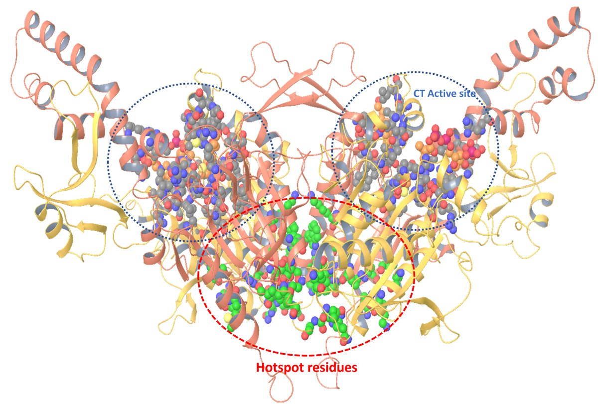



<figure class="rkg-pfig"><figcaption>Modelled ACC structure showing the CT active sites and hotspot residues.</figcaption></figure>

Immobilization by encapsulation, adsorption, covalent binding, or cross-linking simplifies separation and enables reuse and stabilization, at the cost of possible activity loss, support costs, and fouling. Related work covers magnetic metal–organic frameworks with cofactor regeneration for the cascade conversion of bioethanol to acetoin, co-immobilization on magnetic nanoparticles for L-xylulose production, therapeutic enzyme immobilization, and laccase immobilization for bisphenol A degradation. A related strand of enzyme-variant engineering, originating from doctoral work, is a homology-based structural model of acetyl-CoA carboxylase (ACC) from _Ustilago maydis_, which underlies a filed Korean patent on ACC variants with enhanced activity.

**Related publications**

- Novel cofactor regeneration-based magnetic metal–organic framework for cascade enzymatic conversion of biomass-derived bioethanol to acetoin. *Bioresource Technology* 2024. [doi:10.1016/j.biortech.2024.131175](https://doi.org/10.1016/j.biortech.2024.131175)
- Sequential Co-Immobilization of Enzymes on Magnetic Nanoparticles for Efficient L-Xylulose Production. *International Journal of Molecular Sciences* 2024. [doi:10.3390/ijms25052746](https://doi.org/10.3390/ijms25052746)
- Recent Strategies for the Immobilization of Therapeutic Enzymes. *Polymers* 2022. [doi:10.3390/polym14071409](https://doi.org/10.3390/polym14071409)
- Rhus vernicifera Laccase Immobilization on Magnetic Nanoparticles to Improve Stability and Its Potential Application in Bisphenol A Degradation. *Indian Journal of Microbiology* 2021. [doi:10.1007/s12088-020-00912-4](https://doi.org/10.1007/s12088-020-00912-4)
