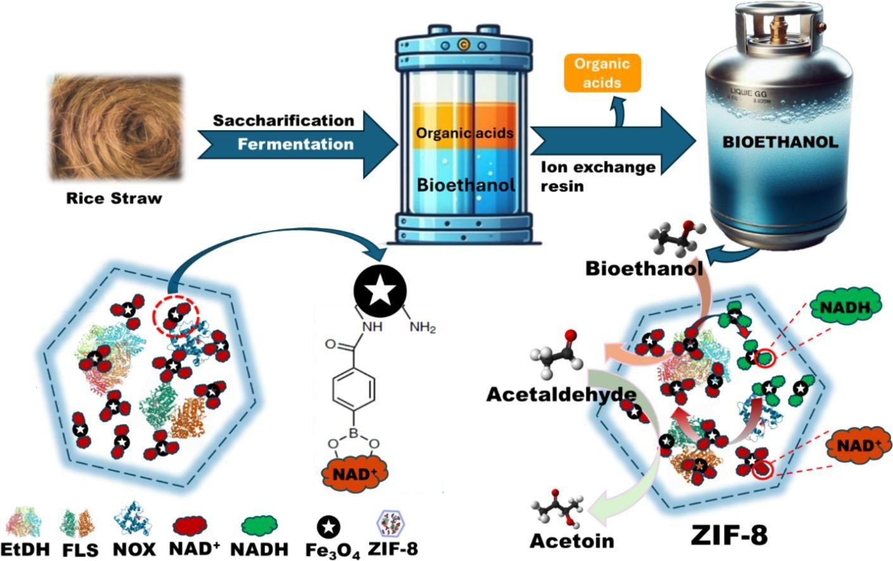



<figure class="rkg-pfig"><figcaption>Bioethanol from rice straw and its cascade enzymatic conversion to acetoin (Gupta et al., Bioresour. Technol. 2024).</figcaption></figure>

Lignocellulosic biomass and waste streams were converted to bioethanol and biohydrogen. Because enzyme cost is a principal expense in cellulosic ethanol production, enzyme and whole-cell immobilization were applied to reduce it. Related work covers immobilized bacteria for hydrogen production, enzyme cocktails for rice-straw saccharification, and the treatment of biodiesel effluent. Rice-straw bioethanol has also served as the feedstock for the cascade enzymatic production of acetoin in a cofactor-regenerating magnetic metal–organic framework.

**Related publications**

- Enhanced Saccharification and Fermentation of Rice Straw by Reducing the Concentration of Phenolic Compounds Using an Immobilized Enzyme Cocktail. *Biotechnology Journal* 2019. [doi:10.1002/biot.201800468](https://doi.org/10.1002/biot.201800468)
- Continuous biohydrogen production from poplar biomass hydrolysate by a defined bacterial mixture immobilized on lignocellulosic materials under non-sterile conditions. *Journal of Cleaner Production* 2021. [doi:10.1016/j.jclepro.2020.125037](https://doi.org/10.1016/j.jclepro.2020.125037)
- Bioprocessing of Biodiesel Industry Effluent by Immobilized Bacteria to Produce Value-Added Products. *Applied Biochemistry and Biotechnology* 2018. [doi:10.1007/s12010-017-2637-7](https://doi.org/10.1007/s12010-017-2637-7)
- Nonsterile Process for Biohydrogen Production: Recent Updates, Challenges, and Opportunities. *Indian Journal of Microbiology* 2024. [doi:10.1007/s12088-024-01319-1](https://doi.org/10.1007/s12088-024-01319-1)
- Recent Developments in Hydrogen Production, Storage, and Transportation: Challenges, Opportunities, and Perspectives. *Fire* 2024. [doi:10.3390/fire7070233](https://doi.org/10.3390/fire7070233)
